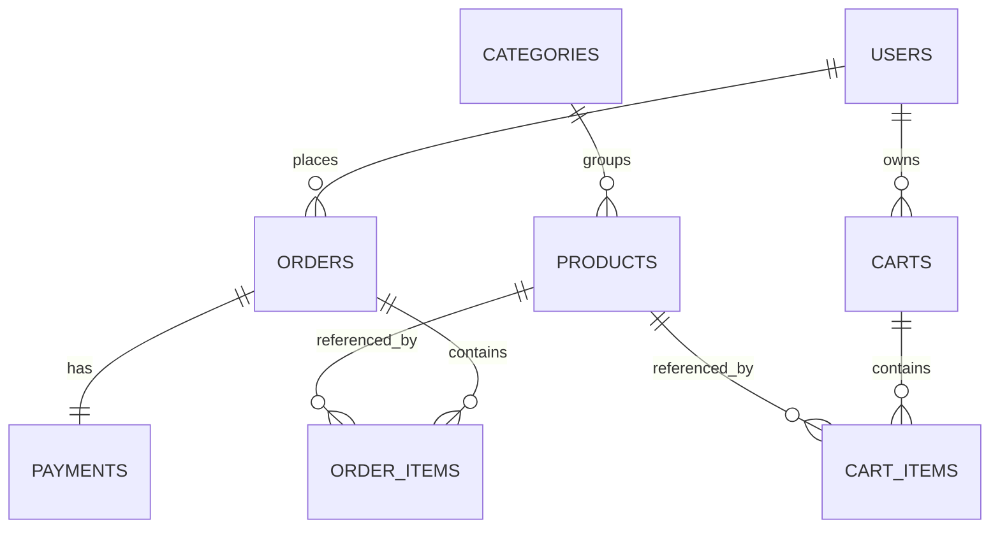

# Workshop Ecommerce

A Laravel 12 + Inertia.js v3 + React (TypeScript) storefront built for a database-design/MVC workshop. It's a working app on day one — but the catalog, cart, and order history are backed by **hardcoded PHP arrays**, not a database. Your job during the workshop is to replace that fake data with real Eloquent models, migrations, and relationships.

## What's already built

- A storefront (`/shop`), cart (`/cart`), checkout (`/checkout`), and order history (`/orders`) that all work end-to-end, reading/writing from `app/Support/Fakes/` instead of a database.
- Customer vs. admin access via a real `users.role` column + a `access-admin` Gate — `/admin/products` and `/admin/orders` are already protected.
- A working **Maya Checkout sandbox integration** (`app/Services/Maya/MayaCheckoutService.php`): it creates a real Maya Checkout session, redirects the buyer to Maya's hosted payment page, and handles the webhook callback that marks an order paid/failed/expired.
- **No database tables exist yet for products, carts, orders, or payments.** Only `users` (plus Laravel's stock auth tables) is a real table right now.

## What you'll build during the workshop

1. **Migrations + Eloquent models + relationships** matching the ERD below.
2. Swap every call to `app/Support/Fakes/{FakeCatalog,FakeCart,FakeOrders}.php` in the controllers for real Eloquent queries — each fake array is already shaped like the model attributes it should become, so this is mostly a mechanical find-and-replace (`grep -r FakeCatalog app/Http/Controllers` to find every call site).
   - `database/seeders/{Category,Product,Cart,Order}Seeder.php` are written against the models you're about to build, and each is a checkpoint: uncomment its line in `DatabaseSeeder::run()` as soon as you finish the matching migration + model. If a column name is off, the seeder fails immediately and tells you exactly which field — a fast way to confirm your schema matches the ERD before moving on.
3. Implement `MayaCheckoutService::buildPayload()` in `app/Services/Maya/MayaCheckoutService.php` — the one piece of the Maya integration left as an exercise: turning an order's line items into the `totalAmount`/`items` structure Maya's Create Checkout API expects. Everything else about the Maya integration (the HTTP call, auth, the webhook handler, redirect handling) is already done.

## ERD



| Table | Columns | Notes |
|---|---|---|
| **users** | `id`, `name`, `email`, `role` (`customer`\|`admin`, default `customer`), ...auth columns | `role` already exists (see `database/migrations/*_add_role_to_users_table.php`) |
| **categories** | `id`, `name`, `slug` (unique), timestamps | one level, no nesting |
| **products** | `id`, `category_id` (FK, nullable), `name`, `slug` (unique), `description` (nullable), `price` (decimal 10,2), `stock_quantity` (int, default 0), `image_path` (nullable), `is_active` (bool, default true), timestamps | consider `SoftDeletes` so `order_items.product_id` survives a deleted product |
| **carts** | `id`, `user_id` (FK, not null), `status` (`active`\|`converted`\|`abandoned`, default `active`), timestamps | one active cart per user — checkout requires login, so no guest cart |
| **cart_items** | `id`, `cart_id` (FK), `product_id` (FK), `quantity`, `unit_price` (decimal 10,2 — **snapshot** of the product's price when added), timestamps | never re-read the live product price for an existing line |
| **orders** | `id`, `user_id` (FK, not null), `order_number` (unique), `status` (`pending`\|`paid`\|`failed`\|`expired`\|`fulfilled`\|`cancelled`), `subtotal`, `discount`, `shipping_fee`, `tax`, `total` (all decimal 10,2), `currency` (default `PHP`), `placed_at`, `paid_at`, `cancelled_at`, timestamps | `status` is the business lifecycle — distinct from `payments.status`, which is Maya's gateway status |
| **order_items** | `id`, `order_id` (FK), `product_id` (FK, nullable), `product_name` (**snapshot**), `unit_price` (**snapshot**), `quantity`, `line_total`, timestamps | snapshots keep historical orders correct even if a product's name/price changes later |
| **payments** | `id`, `order_id` (FK, unique — one payment per order), `provider` (default `maya`), `checkout_id` (unique, nullable), `request_reference_number` (unique), `redirect_url`, `status` (`pending`\|`success`\|`failed`\|`expired`), `currency`, `amount`, `raw_response` (json), `webhook_payload` (json), `paid_at`, timestamps | maps to Maya's `CHECKOUT_SUCCESS`/`CHECKOUT_FAILURE`/`CHECKOUT_DROPOUT` webhooks. A failed/expired Maya session is abandoned and retried as a **brand-new order**, not reused. |

**Relationships:** `Category hasMany Product` · `Product belongsTo Category` · `User hasMany Cart, Order` · `Cart hasMany CartItem` · `CartItem belongsTo Cart, Product` · `Order hasMany OrderItem` · `OrderItem belongsTo Order, Product` · `Order hasOne Payment` · `Payment belongsTo Order`.

## Local setup

```bash
composer install
npm install
cp .env.example .env   # if you don't already have one
php artisan key:generate
php artisan migrate
php artisan db:seed     # creates test@example.com (customer) and admin@example.com (admin), password: "password"
npm run dev
```

### Maya sandbox setup

1. Grab a sandbox public/secret key pair from [Maya's sandbox credentials page](https://developers.maya.ph/reference/sandbox-credentials-and-cards).
2. Set `MAYA_PUBLIC_KEY` and `MAYA_SECRET_KEY` in `.env`.
3. Use one of the sandbox test cards from that same page to pay in the sandbox checkout flow.
4. Maya can't deliver webhooks to `localhost` — use a tunnel (e.g. `ngrok http 8000` or `php artisan serve` + `expose`) and register `https://<your-tunnel>/webhooks/maya` as the webhook URL in your Maya sandbox dashboard so `CHECKOUT_SUCCESS`/`CHECKOUT_FAILURE`/`CHECKOUT_DROPOUT` events actually reach your app.
5. A Maya Checkout session is only valid for **one hour** — if it expires, the customer starts a new checkout, which creates a brand-new order rather than reusing the expired one.
